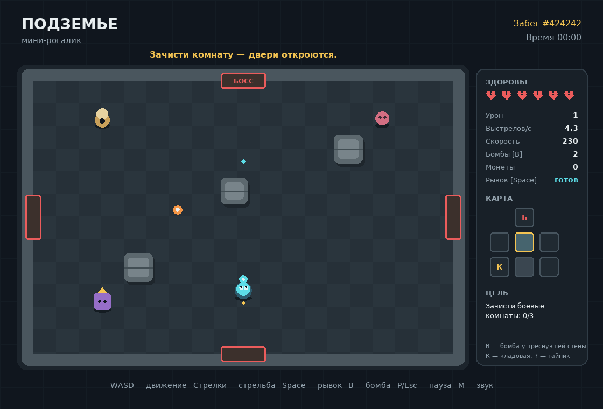

# Подземье — мини-рогалик на Python + Pygame

Небольшая игра в духе **The Binding of Isaac**: вид сверху, комнаты, стрельба, враги, улучшения, бомбы, секретная комната и босс. Это не клон и не копия ассетов Isaac — графика рисуется кодом, звук синтезируется, проект учебный и самостоятельный.



## Что есть в игре

- **8 комнат**: вход, кладовая с улучшением, 4 боевые комнаты, логово босса и тайник.
- **Стрельба снарядами** по стрелкам, враги тоже стреляют.
- **3 типа врагов**: преследователь, стрелок и рывковый враг с телеграфом атаки.
- **Босс «Страж корней»**: две фазы, круговые снаряды, прицельные очереди и призыв помощников.
- **Рывок** с короткой неуязвимостью и перезарядкой.
- **Бомбы**: взрывают врагов, ломают камни и открывают треснувшую стену в тайник.
- **Улучшения**: урон, скорострельность, скорость, контейнер сердца, пробивание, двойной выстрел.
- **Мини-карта**, счёт, здоровье, таймер забега, экраны победы/поражения, пауза.
- **Синтезированные звуковые эффекты** без внешних аудиофайлов. Если аудиоустройство недоступно, игра продолжает работать без звука.
- **Seed забега**: можно запустить повторяющуюся генерацию, например `python main.py 42`.

## Управление

| Клавиши | Действие |
|---------|----------|
| `W A S D` | движение |
| `Стрелки` | стрельба в соответствующем направлении |
| `Space` | рывок с короткой неуязвимостью |
| `B` | поставить бомбу |
| `P` / `Esc` | пауза |
| `M` | включить/выключить звук |
| `Enter` | начать игру с титульного экрана |
| `R` | новый забег после победы/поражения или из паузы |

Двери боевой комнаты закрыты, пока все враги не побеждены. Чтобы снять печать с логова босса, зачисти **3 из 4 боевых комнат**. Треснувшую стену можно подорвать бомбой — за ней тайник с улучшением и сердцем.

## Быстрый запуск в VS Code

Нужен **Python 3.10 или новее** и расширение **Python** от Microsoft в VS Code.

1. Открой папку проекта: **File → Open Folder**.
2. Открой терминал: **Terminal → New Terminal**.
3. Создай виртуальное окружение и установ зависимость:

### Windows

```powershell
python -m venv .venv
.venv\Scripts\activate
python -m pip install -r requirements.txt
python main.py
```

Если PowerShell запрещает активацию скрипта, можно не активировать окружение, а запускать так:

```powershell
python -m venv .venv
.venv\Scripts\python.exe -m pip install -r requirements.txt
.venv\Scripts\python.exe main.py
```

### macOS / Linux

```bash
python3 -m venv .venv
source .venv/bin/activate
python -m pip install -r requirements.txt
python main.py
```

После активации окружения в VS Code выбери интерпретатор: `Ctrl+Shift+P` → **Python: Select Interpreter** → `.venv`. Затем можно открыть `main.py` и нажать **Run Python File** ▶.

Повторный запуск после установки:

```bash
python main.py
```

Повторяемый забег:

```bash
python main.py 42
```

## Структура проекта

```text
.
├── main.py                 # вся логика и отрисовка игры
├── requirements.txt        # зависимость Pygame
├── readme.md               # этот файл
├── .gitignore
├── assets/
│   ├── DejaVuSans.ttf      # шрифт для кириллицы
│   ├── DejaVuSans-Bold.ttf
│   └── FONT-LICENSE.txt    # лицензия шрифтов DejaVu
├── screenshots/            # скриншоты для README
└── tests/
    └── test_game.py        # автотесты логики
```

## Автотесты

Тесты проверяют карту, спавн и зачистку комнат, снаряды, печать босса, бомбы/тайник, улучшения, рывок, паузу, переходы между комнатами, победу, поражение и перезапуск.

```bash
python -m unittest discover -s tests -v
```

Ожидаемый результат: `OK`, 13 тестов. Тесты используют dummy-драйверы SDL и не открывают окно.

## Как играть эффективно

- Двигайся и стреляй одновременно: `WASD` + стрелки.
- Рывок (`Space`) помогает проходить через снаряды и выходить из окружения.
- Перед боем посмотри мини-карту: `К` — кладовая, `Б` — босс, `?` — тайник после открытия.
- Бомбы не только наносят урон, но и ломают камни. Не стой слишком близко к своему взрыву.
- В кладовой обязательно забери улучшение. За каждые две зачищенные боевые комнаты появляется ещё одно.
- Сердце подбирается только если здоровье не полное.
- Во второй фазе босс быстрее и призывает помощников — сначала убери мелких врагов.

## Частые проблемы

**`ModuleNotFoundError: No module named 'pygame'`**  
Установи зависимость в том же окружении, которым запускаешь игру:

```bash
python -m pip install -r requirements.txt
```

В VS Code проверь, что выбран интерпретатор из `.venv`.

**`python` не найден**  
Попробуй `python3` на macOS/Linux или `py` на Windows. Установи Python с https://www.python.org/downloads/ и включи **Add Python to PATH** в Windows.

**Нет звука**  
Нажми `M`. Если аудиоустройство или системные библиотеки недоступны, игра работает молча — это не краш.

**Окно маленькое/масштабированное**  
Игра использует фиксированное логическое разрешение 1120×760 и масштабирование Pygame. Это нормально для небольших мониторов.

## Git и GitHub

В проекте уже есть Git-репозиторий и история коммитов. После изменений:

```bash
git status
git add main.py requirements.txt readme.md .gitignore assets screenshots tests
git commit -m "Describe your change"
```

Если открываешь копию без папки `.git`:

```bash
git init -b main
git config user.name "Ваше имя"
git config user.email "ваша-почта@example.com"
git add .
git commit -m "Add Podzemlye roguelike game"
```

### Загрузка на GitHub

1. Создай пустой репозиторий на https://github.com/new, например `podzemlye-roguelike`.
2. **Не добавляй** README, `.gitignore` и лицензию при создании — файлы уже есть локально.
3. Подставь свой URL:

```bash
git branch -M main
git remote add origin https://github.com/ВАШ_ЛОГИН/podzemlye-roguelike.git
git push -u origin main
```

Если `origin` уже существует:

```bash
git remote set-url origin https://github.com/ВАШ_ЛОГИН/podzemlye-roguelike.git
git push -u origin main
```

При запросе авторизации войди через браузер или используй Personal Access Token вместо пароля. Не сохраняй токен в файлах проекта. После первого push следующие обновления отправляются командой `git push`.

## Лицензии

Игровой код написан для этого проекта. Шрифты DejaVu распространяются по своей лицензии, текст лежит в `assets/FONT-LICENSE.txt`. Pygame — сторонняя библиотека, устанавливается через `requirements.txt`.
